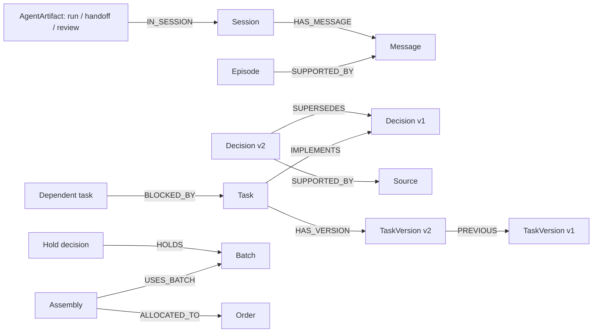

# RelayMind

**Agents that remember decisions, hand off work and catch outdated plans using FalkorDB.**

Graph Hacks · Primary track: **Agent Memory and Coordination** · Hackathon prototype

## 1. What the project is about and what it solves

Business decisions change, but agents can continue working from yesterday's conversation. A launch plan still includes postponed payments, a logistics plan still uses a closed port, or a quality response misses orders exposed by an expanded hold. Handing that plan to another agent helps only if it can recover the evidence and check what is current.

RelayMind stores conversations, sourced historical episodes, approved decisions, procedures and agent handoffs in FalkorDB. A **Planner** proposes next steps and saves a cited handoff. An independent **Reviewer** reloads it and checks current records and the pinned review procedure. Changed evidence or decisions can require revision; the workflow allows one correction round and reports the actual outcome.

People review the plan and separately approve supported task/order updates. **Approving a plan records intent; it applies no business changes.** Supported actions update synthetic records in the demo graph. Shipping, payment and external messaging systems are not connected.

### Why the graph matters



A current approved decision has no incoming `SUPERSEDES` edge. Multiple current decisions on one topic are reported as a conflict. `IMPLEMENTS` links reveal work based on replaced decisions; batch/assembly/order links reveal manufacturing impact. Saved handoff payloads retain proposals, evidence snapshots and procedure references for independent review.

Agents use validated read-only tools backed by parameterized queries. For example:

```cypher
MATCH (d:Decision)-[:ABOUT]->(:Project {id: $project})
WHERE NOT (d)<-[:SUPERSEDES]-(:Decision)
OPTIONAL MATCH (d)-[:SUPPORTED_BY]->(s:Source)
RETURN d.id, d.topic, d.text, collect(DISTINCT s.id)
```

The server selects the authorized tenant graph and groups results to detect conflicts. Models never select graphs or write arbitrary Cypher. Read the [technical architecture and graph reference](docs/submission-drafts/README.md) for the complete model, request lifecycle and implementation links.

## 2. Setup and manual instructions

### Try the hosted demo

Deployment and video URLs are pending publication in the [submission details](docs/submission-drafts/SUBMISSION.md#submission-links-and-human-details--pending). Use the URL and demo password supplied by the team when available. Start with the [five-minute user walkthrough](docs/submission-drafts/USER-MANUAL.md#2-five-minute-browser-walkthrough).

### Run locally

Requirements: Python 3.11+, Node.js 20.19+ or 22.12+, and Docker with Compose. Commands below use macOS/Linux; on Windows use `.venv\Scripts\python` instead of `.venv/bin/python` and your shell's copy command.

```sh
git clone https://github.com/jay2323-tech/RelayMInd.git
cd RelayMInd
cp .env.example .env
```

Edit `.env` locally:

- Set `FALKORDB_PASSWORD` and `RELAYMIND_DEMO_PASSWORD`.
- Set `AGENT_PROVIDER=gemini`, an available `GEMINI_MODEL`, and your `GEMINI_API_KEY`.
- Optional fallback: configure `AGENT_FALLBACK_PROVIDER=groq`, `GROQ_MODEL` and `GROQ_API_KEY`. Leave `AGENT_FALLBACK_PROVIDER` empty to disable fallback. Model availability depends on your provider account.

Keep credentials server-side and out of Git. Then run:

```sh
docker compose up -d
python3 -m venv .venv
.venv/bin/python -m pip install -r backend/requirements.lock.txt
.venv/bin/python -m pip install -e "./backend[employee-import]"
.venv/bin/python scripts/setup_graph.py
.venv/bin/python scripts/seed_northstar.py --stage before-change
.venv/bin/python scripts/seed_harbor.py --stage before-change
.venv/bin/python scripts/seed_adventureworks.py --stage before-change
```

Install frontend dependencies in another terminal:

```sh
cd frontend
npm ci
```

From the repository root, start the local backend, reminder worker and development UI:

```sh
.venv/bin/python scripts/start_demo.py --frontend
```

Open `http://127.0.0.1:5173` and sign in with an account below and the password configured in `RELAYMIND_DEMO_PASSWORD`. Login is disabled if that value is unset. Restarting the backend requires signing in again; graph persistence is separate from login sessions. The starter is for local development, not a production deployment recipe.

### Use the app

Choose **+ New conversation**, ask a factual question or request a plan, and inspect **Sources**, **Details** and **Activity**. Composer **Options → Pause before independent review** saves a checkpoint; **Continue to review** resumes it. Plan decisions and **Business changes** have separate controls and receipts.

See the [user manual](docs/submission-drafts/USER-MANUAL.md) for exact prompts, work setup, reminders, troubleshooting and the tester checklist. The [demo guide](docs/submission-drafts/DEMO.md) gives a narrated walkthrough and verification scope.

## 3. Test datasets, accounts and scenarios

These scenarios model real operational problems using **fictional data**. Seed scripts load the records into FalkorDB; the provider then runs against that graph. A fixture file is not an executed result. Shared demo state may already have been changed by another tester, so confirm the active stage with the host.

| Account | Chosen operational problem | What to test |
|---|---|---|
| `northstar.lead` · `launch-01` | A software launch changes scope after work has been planned | Saved handoff, stale-decision detection, revised task coverage and separately approved task pause |
| `northstar.peer` · `launch-01` | Colleagues share approved project knowledge but need private conversations | Same-company conversation privacy and separately scoped approval history |
| `harbor.lead` · `hb-route-07` | A port closure invalidates a shipment route and promised delivery date | Revised route, affected booking/customer-confirmation tasks and cross-company separation |
| `aw.quality` · `aw-qh-17` | An expanded manufacturing quality hold exposes additional customer orders | Multi-hop impact, shipped-versus-open handling, unknown traceability and approved order hold |

### Northstar: a launch plan becomes outdated

**Problem:** The original decision launches Friday with payments. Its replacement postpones payments and launches only the free tier.

1. Sign in as `northstar.lead`. Ask **“What are the current decisions?”**
2. For the change test, start with the before-change stage, create a new conversation and enable **Pause before independent review**.
3. Ask **“Continue launch preparation. What changed, and what should we do next?”** Inspect the saved proposal citing `decision-01`.
4. Have the operator apply the replacement decision using the command below, then click **Continue to review**.
5. Check that the old basis is detected as changed. A complete revised proposal uses `decision-02` and addresses `task-01` and `task-02`. Inspect the actual final review; acceptance is not guaranteed on every model run.
6. For a current accepted proposal, optionally **Approve plan**. To test execution separately, use **Business changes → Prepare task pause → Approve this change**, then inspect the applied receipt/version history.

### Northstar peer: private conversation boundaries

Create a conversation as `northstar.lead`, then sign out and sign in as `northstar.peer`. The peer should not see the lead's private conversation. Ask **“What are the current decisions?”** to inspect shared project knowledge, and **“What did I approve?”** to inspect this user's own recorded decisions. Seeded decisions must not be described as the peer's approvals.

### Harbor: a closed port changes the route

**Problem:** HB-O201 was planned via Route A through Port North for Friday delivery. A closure forces Route B through Port South and Saturday delivery instead.

1. Sign in as `harbor.lead`. Ask **“What are the current decisions?”**
2. After the operator applies the after-change stage, ask **“What changed?”** and **“Which tasks are affected?”**
3. Request **“Port North changed our plans. What changed for HB-O201 and what should dispatch and account management do next?”**
4. Check the new route decision `hb-dec-route-v2`, affected tasks `hb-task-book-route-a` and `hb-task-confirm-friday`, and the requirement to notify Coldline Foods before confirming a delivery date. The new plan must not continue promising Friday under the replacement route.
5. Open Sources to inspect the closure and replacement plan. Pausing a supported task changes its graph record; it does not book a carrier or send a customer message.

### AdventureWorks: an expanding quality hold

**Problem:** Hold QH-17 initially covers batch AW-B101. Its expansion adds AW-B102, exposing an additional order through assembly/batch relationships.

1. Sign in as `aw.quality`. Ask **“Which orders are exposed?”**
2. Before-change expectation: AW-O101 and AW-O102. After-change expectation: those orders plus AW-O103.
3. In both stages, AW-O105 must stay **unknown traceability**, not proven safe. Shipped AW-O102 needs exposure review; it is not an open order to put on hold.
4. Ask **“Investigate hold QH-17, identify affected orders, evaluate replacement options and prepare an owned recovery plan. Do not approve shipments or replacements.”** Inspect the actual plan, citations, uncertainties and review result.
5. After expansion, an eligible open AW-O103 can receive a separately proposed and approved graph hold through **Business changes** or **Sources → Actions**. Inspect the receipt and order version.

### Operator controls and dataset locations

For a clean test on disposable local data, use `.venv/bin/python scripts/demo_reset.py --scenario northstar`, `harbor` or `aw`. Reset preserves sessions/runs/procedures, so use a fresh conversation; do not reset a shared deployment while others are testing.

Apply a change **after** inspecting the before-change state:

| Scenario | Operator command from repository root |
|---|---|
| Northstar | `.venv/bin/python scripts/seed_northstar.py` |
| Harbor | `.venv/bin/python scripts/seed_harbor.py --stage after-change` |
| AdventureWorks | `.venv/bin/python scripts/seed_adventureworks.py --stage after-change` |

| Dataset | Purpose |
|---|---|
| [Northstar](fixtures/northstar.json) | Launch decisions, sourced history, procedures and versioned tasks |
| [Harbor](fixtures/harbor-route-change.json) | Port notice, route versions, customer terms and affected tasks |
| [AdventureWorks incident](fixtures/adventureworks/quality-hold.json) | Synthetic hold stages, source documents, batch/assembly/order links and acceptance cases |
| [Company directories](fixtures/companies/) and [AdventureWorks directory](fixtures/adventureworks/directory.json) | Supporting synthetic/sample organization data; not a completed directory-upload or agent-directory UI |
| [Test-only cases](fixtures/test-scenarios.json) | Conflict/outdated-handoff verification; not ordinary demo data or hardcoded model answers |

AdventureWorks employee data derives from Microsoft's fictional sample database. Its [provenance](fixtures/adventureworks/provenance.json) and [Microsoft license notice](fixtures/adventureworks/MICROSOFT-LICENSE.txt) are retained. The quality-hold incident is original synthetic content, not a historical Microsoft event. Acceptance expectations are test oracles, not answers supplied to the model.

## 4. Features and detailed documentation

| Feature | Detail |
|---|---|
| Persistent conversation and sourced episodic memory | [Memory, persistence and access checks](docs/submission-drafts/USER-MANUAL.md) |
| Current decisions, history and conflicts | [Graph model and query examples](docs/submission-drafts/README.md#why-falkordb-is-central) |
| Planner, saved handoff and independent Reviewer | [Core walkthrough and actual review outcomes](docs/submission-drafts/USER-MANUAL.md) |
| Pause/resume and changed-context revision | [Operator-assisted change demonstration](docs/submission-drafts/DEMO.md) |
| Source inspection and per-step citations | [Feature table and UI instructions](docs/submission-drafts/USER-MANUAL.md) |
| Human plan approval, rejection, changes and decision history | [Approval semantics](docs/submission-drafts/USER-MANUAL.md#4-understand-plan-review-and-business-changes) |
| Separate supported task/order changes with version checks | [Action walkthroughs](docs/submission-drafts/USER-MANUAL.md) |
| Manufacturing impact and unknown traceability | [Manufacturing test guide](docs/submission-drafts/USER-MANUAL.md#6-test-manufacturing-impact) |
| Staleness alerts and bounded deterministic answer checks | [Technical architecture](docs/submission-drafts/README.md) |
| Guided work setup and worker-delivered in-app reminders | [Setup fields, scheduling and snooze](docs/submission-drafts/USER-MANUAL.md#7-set-up-work-and-reminders) |

### Verification and limitations

```sh
.venv/bin/python -m pytest backend/tests
# Optional live FalkorDB checks; these do not imply every test calls a real model:
RUN_LIVE_FALKORDB_TESTS=1 .venv/bin/python -m pytest backend/tests
node --test frontend/tests/activityState.test.ts frontend/tests/trackState.test.ts frontend/tests/memoryLinks.test.ts
```

Frontend build: run `npm run build` from `frontend/`. See the [dated verification snapshot](docs/submission-drafts/DEMO.md#verification-snapshot) for observed results and what remains unverified. No fresh deployment success is claimed by this README.

Limits: synthetic demo accounts and shared password; in-memory login sessions and single API-process job management; bounded lexical search; variable model/provider reliability; in-app reminders requiring a worker; no external shipping/payment/email/Slack integrations. Model review is not a guarantee of semantic correctness, and production-scale concurrency is not claimed.

### Team and submission material

**Jayanth Krishna + Claude Code:** graph/platform responsibilities. **Kanak Garg + Codex:** agent memory/coordination responsibilities. Read [team contributions and AI assistance](docs/submission-drafts/TEAM-CONTRIBUTIONS.md) for the agreed split and substantial AI-assisted implementation.

[User manual and tester checklist](docs/submission-drafts/USER-MANUAL.md) · [Technical reference](docs/submission-drafts/README.md) · [Demo and verification guide](docs/submission-drafts/DEMO.md) · [Submission write-up](docs/submission-drafts/SUBMISSION.md)
