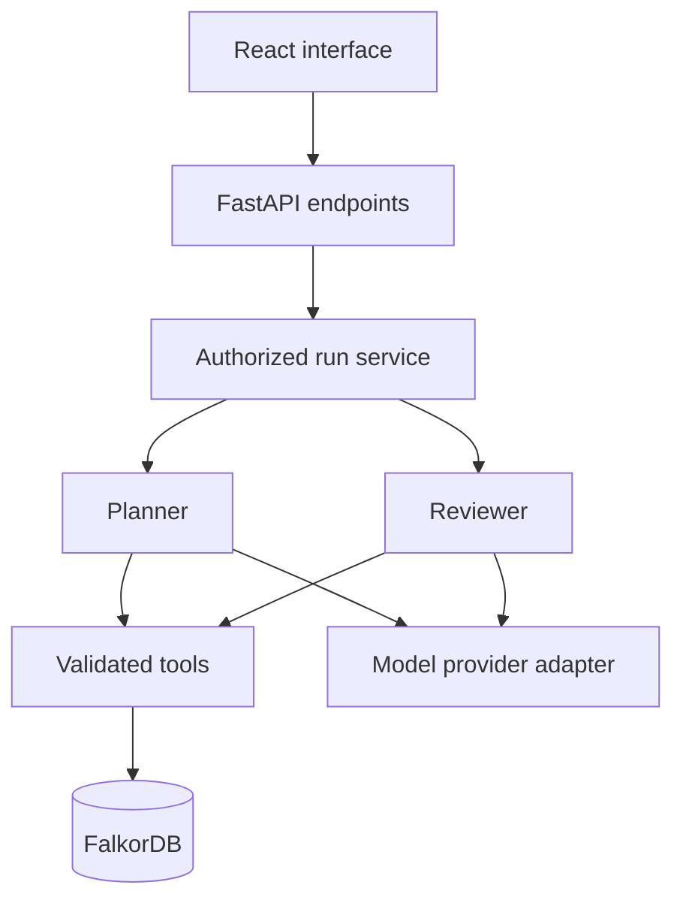

# Architecture

Only the liveness API and frontend foundation are implemented. The graph client is
configured but is not called by liveness. Agent engine, identity, graph persistence,
run API, and model adapter are future work.

Persist messages, episodes, decisions, procedures, plans, handoffs, reviews and
operation IDs in FalkorDB. Keep request-local context transient. Tenant selection
comes from verified identity. Source text is data, never authority to execute tools.
Planner and Reviewer share persisted state; the Reviewer independently retrieves
current decisions and sources. Stop after one correction round. Actions are separate
from planning and require approval plus a fresh version check.

Provider choice is pending. No framework or queue is required for the initial loop.
Use polling for run progress. Do not expose run endpoints until authorization exists.
