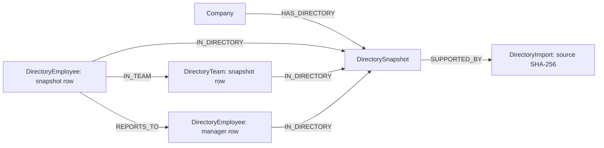

# Synthetic company directories and employee import

## Status and scope

Requested by Jayanth on 17 October 2026. This additive directory milestone includes
three fictional organization fixtures, validation, a preview-first operator CLI,
and a FalkorDB snapshot writer/reader. It does not replace the existing Northstar
launch seed. The directory employees are NOT automatically linked to existing
`Person` task owners: those older fixtures use different IDs and names.

Excel parsing is implemented; HTTP upload, a preview/confirm UI, directory tools
for Planner/Reviewer, and multi-company app switching are not implemented here.
Harbor and Cedar do not yet have complete launch conversations/decisions/tasks or
real-model runs. A directory dataset alone is not a memory retrieval benchmark.

Verification on 17 October: 19 focused checks passed, including real local
FalkorDB snapshot write/read, repeated import without duplicate member rows,
reporting-edge counts, cross-company read denial, and preserving an earlier
snapshot after a role change. Live checks redirected storage to one uniquely
named disposable test graph, then deleted only that graph. Existing demo graphs
were not written. Docker reports the running image as `falkordb/falkordb:latest`;
this check does not establish compatibility with a separately pinned image.

Every company and person is fictional. Similar names are intentional in places
(Harbor and Cedar both have an Alex Kim): names must never be identity keys.
Use synthetic spreadsheets only for this hackathon. A `synthetic: true` label or
CLI confirmation cannot detect whether someone has supplied actual personal data.

## Dataset

| Company | Industry | Employees | Teams and active size |
|---|---|---:|---|
| Northstar | Software | 12 | Leadership 1; Product 3; Engineering 5; People and Operations 3 |
| Harbor Logistics | Logistics software | 15 | Leadership 1; Operations 6; Platform 5; People and Operations 3 |
| Cedar Learning | Education software | 12 | Leadership 1; Curriculum 4; Platform 4; People and Operations 3 |

Full employee names, roles, skills, team IDs, stable employee IDs, active status,
and reporting lines are in `fixtures/companies/{northstar,harbor,cedar}.json`.
Totals are computed from validated employee rows; do not separately store a
manually edited headcount. This MVP supports one primary team per employee and
zero or one manager. Matrix organizations and dated assignments are future work.

The 15 answer-key cases in `fixtures/companies/acceptance-questions.json` cover
counts and membership. Tests verify the answer keys against fixtures. They do
not measure LLM answer quality or retrieval accuracy.

## Database model



Identity and versioning:

- Logical employee identity: `(company_id, employee_id)`. Names are display text.
- Snapshot identity: `company_id:SHA256(canonical validated directory JSON)`.
  Sort teams, employees and skill sets before hashing. Reordering the workbook
  alone does not produce a different logical snapshot.
- Graph employee/team node IDs include the snapshot ID. Old reporting lines and
  roles remain historical. A newer roster does not erase an older one.
- Import provenance records the source-file SHA-256. The snapshot payload retains
  validated employee IDs/values; use employee ID to locate the original row.
  The original workbook is not stored. Fingerprints are not encryption or proof
  that the source is authoritative.
- Snapshot reads require an explicit ID; there is no automatic "current" pointer
  yet. Future activation needs an authorized human confirmation with an expected
  base snapshot, conflict protection and an audit event.
- Existing Project/Task/Person/Decision data remains separate. Future ownership
  links need an explicit reviewed ID mapping; never infer them from names.

Fixed local-demo access (NOT login/authentication):

| Trusted server context | Company | Graph |
|---|---|---|
| demo-a / developer-a | northstar | relaymind_demo_a |
| demo-b / developer-b | harbor | relaymind_demo_b |
| demo-c / developer-c | cedar | relaymind_demo_c |

All use the existing allowed `launch-01` project key in separate graphs. Neither
the spreadsheet nor the model can choose a graph. The CLI is an operator tool;
do not expose it as an HTTP endpoint without actual authorization. New demo-c
mapping does not configure API identity, setup_graph.py constraints or the UI.

## Excel contract and workflow

Install the optional parser dependencies:

```sh
.venv/bin/python -m pip install -e './backend[employee-import]'
```

Exact optional parser versions are recorded in
`backend/requirements-employee-import.lock.txt`; install that alongside the base
backend lock when reproducing this environment.

Create an `.xlsx` file with an `Employees` sheet and EXACTLY these seven headers,
in order, with text-valued cells:

| employee_id | name | team_id | role | manager_id | status | skills |
|---|---|---|---|---|---|---|
| northstar-leadership-01 | Maya Sen | leadership | Chief executive | | active | Strategy |
| northstar-engineering-01 | Zara Khan | engineering | Engineering lead | northstar-leadership-01 | active | Architecture;Review |

Supply the full company roster, not a partial patch. Team IDs must exist in the
company fixture. Blank manager means no listed manager. `status` is `active` or
`inactive`. Skills are semicolon-separated. Names alone do not establish identity.
Unknown columns, including extra HR fields, are rejected. Never upload salary,
addresses, phone numbers, identity documents or real personnel information.

Preview fixtures (no DB/model calls):

```sh
.venv/bin/python scripts/import_company_directory.py --company northstar
.venv/bin/python scripts/import_company_directory.py --company harbor
.venv/bin/python scripts/import_company_directory.py --company cedar
```

Preview a fictional employee workbook:

```sh
.venv/bin/python scripts/import_company_directory.py --company northstar --xlsx /path/to/synthetic-employees.xlsx --confirm-synthetic
```

Only after reviewing, repeat with `--apply` to write a snapshot. Docker must be
running and `.env` must contain your local FalkorDB configuration. Do not reset
the existing launch demo. A directory import does not approve a decision or task.

Validation: 5 MiB compressed limit, 25 MiB declared expanded ZIP limit, bounded
ZIP entries, max 1000 employee rows, formulas/macros rejected, strict fields,
unique IDs, team/manager references, and reporting-cycle detection. This is not a
complete hostile-file sandbox. A public upload service additionally needs upload
limits enforced before reading, worker time/memory limits, real identity/access
checks, preview persistence, approval and audit logging.

## Essential queries (proposed read tools)

All parameters come from verified server context/validated IDs. These examples
must be exercised against the pinned database before exposing them as tools.

```cypher
// Active headcount in a specific, authorized company snapshot.
MATCH (:Company {id:$company})-[:HAS_DIRECTORY]->(d:DirectorySnapshot {id:$snapshot})
MATCH (e:DirectoryEmployee {status:'active'})-[:IN_DIRECTORY]->(d)
RETURN count(DISTINCT e) AS active_employees
```

```cypher
// Team members and their direct managers, confined to the selected snapshot.
MATCH (:Company {id:$company})-[:HAS_DIRECTORY]->(d:DirectorySnapshot {id:$snapshot})
MATCH (t:DirectoryTeam {team_id:$team})-[:IN_DIRECTORY]->(d)
MATCH (e:DirectoryEmployee)-[:IN_TEAM]->(t)
OPTIONAL MATCH (e)-[:REPORTS_TO]->(m:DirectoryEmployee)
RETURN e.employee_id, e.name, e.role, e.status, m.employee_id
ORDER BY e.employee_id
```

## Algorithms and textbook concepts

| Concept | Concrete application | Status |
|---|---|---|
| Referential integrity and composite keys | Reject unknown teams/managers; never merge equal names across companies | Implemented in directory validation |
| DAG cycle detection / topological sorting | Reject self-reporting and management loops in O(V+E) | Implemented with Python graphlib |
| Content addressing / SHA-256 | Idempotent logical snapshot IDs; detect payload changes | Implemented; not a security signature |
| Immutable snapshots / temporal data | Preserve earlier roles and reporting lines | Writer implemented; activation/history UI pending |
| BFS with depth/edge filters | Find an escalation path or downstream affected tasks with an explanation | Existing task queries; directory traversal tool pending |
| Inverted index + embeddings + Reciprocal Rank Fusion | Combine exact employee/project names with semantic relevance | Proposed retrieval milestone |
| Provenance and grounded answers | Cite snapshot, employee ID and import source rather than inventing an owner | Directory provenance implemented; agent citations pending |
| Optimistic concurrency control | Refuse approval when the underlying task/decision changed | Existing task action feature; directory activation pending |
| Precision@k, Recall@k, MRR | Measure irrelevant hits, missed relevant records and first correct result | Directory LLM benchmark pending |

RRF combines retrieval ranks, not incompatible raw keyword/vector scores. Apply
access filters before retrieval and graph expansion. Approved decision state is a
hard constraint, not a ranking bonus. Similarity does not prove a claim true.

PageRank or community detection can be experiments for knowledge navigation;
neither determines employee authority, managerial ownership or factual truth.
Avoid adding algorithms without a question and a labelled evaluation.

References: [Python graphlib](https://docs.python.org/3/library/graphlib.html),
[FalkorDB graph algorithms](https://docs.falkordb.com/algorithms/),
[official event rules](https://www.wemakedevs.org/hackathons/falkordb/rules).

## Next integration steps

1. Exercise snapshot write/read/idempotency on the pinned FalkorDB image. Add
   unique constraints for directory identities and independent-process tests
   before claiming safe concurrent imports.
2. Add authenticated preview/confirm API and a small upload screen. Preserve
   server-owned company scope; add manager/role change diffs before confirmation.
3. Add explicit approved snapshot selection and directory read tools to agents.
4. Add Harbor dispatch-change and Cedar sign-in-change scenarios with sourced
   conversations, approved decisions, tasks and procedures using existing schemas.
5. Evaluate paraphrases, duplicate names, changed managers, absent employees and
   cross-company queries. Report measured results, including failures.
