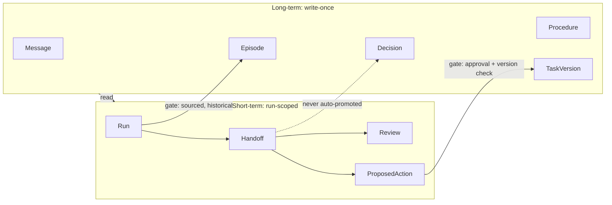

# RelayMind memory design v1

Status: **agreed design, not implemented.** Nothing here is implemented unless it
names a file already on `main`. Items marked **UNVERIFIED** must not be relied on
until the named check or test has actually run and passed; record results in
docs/verification.md.

Model provider: **open decision.** It blocks the Planner/Reviewer milestones only.
Decision memory, task versions, evidence and approvals do not depend on it.

---

## 1. The idea in plain words

RelayMind has **two tiers of memory**, both stored in FalkorDB.

| Tier | Plain meaning | Lifetime | Records |
|---|---|---|---|
| **Short-term (working)** | What this run is doing now | One run. Has a lifecycle status; finished records are kept, never deleted | Run, Handoff, Review, ProposedAction |
| **Long-term** | What we know and what happened | Permanent. Records are **write-once**; change means a new version node | Message, Episode, Decision, Procedure, Task/TaskVersion |

Between the tiers are **promotion gates**. Nothing an agent produces becomes
long-term truth unless a gate allows it.

Rules:

1. **Short-term is persisted, not held in process memory.** The Reviewer loads
   the handoff from FalkorDB. Only the prompt text for one model call is transient.
2. **Expire, don't delete.** Finished runs keep handoffs and reviews for audit.
3. **History and truth are different node types.** Episodes are history.
   Decisions are current truth. They are never mixed in one answer without labels.
4. **Long-term records are immutable.** Their content properties are set at
   creation and never updated. Short-term records may change `status` along
   their lifecycle only.



---

## 2. Immutable versioning

There are two patterns. Both share one principle: **"current" is derived from
relationships, never from a stored status, timestamp or highest number.**

### 2.1 Decisions: supersession chain

A Decision node is an approved statement. It is created once by a
human-attributed operation and never edited.

```
(:Decision {id, topic, version, text, approved_by, approved_at, created_at})
(:Decision)-[:ABOUT]->(:Project)
(:Decision)-[:SUPPORTED_BY]->(:Source)
(:Decision)-[:SUPERSEDES {reason, at}]->(:Decision)
```

- There is **no `status` property.** Agent proposals are not Decision nodes; they
  live inside a Plan. A Decision node exists only once a person approved it.
- `topic` is a short, human-assigned key (`launch-scope`, `pricing`). Versioning
  and conflicts are scoped to `(project, topic)`.
- **Linking a new version:** the new Decision is created together with
  `SUPERSEDES` edges to every decision it replaces, in one write operation.
  Rules checked by that operation:
  - each replaced decision is in the same project and the same topic;
  - each replaced decision is **current** at the time of the write;
  - the new `id` is unused.
  Because edges only go from the new node to existing nodes, cycles cannot be
  created through this operation.
- `version` = 1 for the first decision on a topic, otherwise
  `1 + max(version of replaced decisions)`. It is **display information only.**
  It is never used to choose the current decision.
- A new decision may replace several current decisions at once. That is how a
  person resolves a conflict (§3).
- To retract a topic without a replacement policy, a person records a new
  decision whose text states the retraction. It supersedes the old one normally.

**Current decision** = a Decision in the project with **no incoming `SUPERSEDES`.**

Default query form (plain aggregation, does not depend on pattern predicates):

```cypher
MATCH (d:Decision)-[:ABOUT]->(:Project {id: $project_id})
OPTIONAL MATCH (d)<-[:SUPERSEDES]-(newer:Decision)
WITH d, count(newer) AS successors
WHERE successors = 0
OPTIONAL MATCH (d)-[:SUPPORTED_BY]->(s:Source)
RETURN d.id, d.topic, d.version, d.text, d.approved_at, collect(s.id) AS source_ids
ORDER BY d.topic, d.id
```

Shorter form, **UNVERIFIED** on our FalkorDB version (compatibility check C-1, §6):

```cypher
MATCH (d:Decision)-[:ABOUT]->(:Project {id: $project_id})
WHERE NOT (d)<-[:SUPERSEDES]-(:Decision)
...
```

Implementation uses the default form unless C-1 passes and the team chooses to switch.

**History of a topic:**

```cypher
MATCH (d:Decision {topic: $topic})-[:ABOUT]->(:Project {id: $project_id})
OPTIONAL MATCH (d)-[:SUPERSEDES]->(old:Decision)
RETURN d.id, d.version, d.text, d.approved_at, collect(old.id) AS replaces
ORDER BY d.version, d.id
```

### 2.2 Tasks: identity node plus version chain

A task changes status and owner over time, so it gets a stable identity node and
one immutable node per version.

```
(:Task {id, created_at})                         // identity, never changes
(:Task)-[:ABOUT]->(:Project)
(:Task)-[:HAS_VERSION]->(:TaskVersion)
(:TaskVersion {id, task_id, version, version_key, title, status,
               created_at, created_by})
(:TaskVersion)-[:PREVIOUS]->(:TaskVersion)       // v(n) -> v(n-1); none for v1
(:TaskVersion)-[:ASSIGNED_TO]->(:Person {id, name})
(:TaskVersion)-[:CAUSED_BY]->(:ProposedAction)   // absent for seeded v1

// structure, attached to the identity node
(:Task)-[:BLOCKED_BY]->(:Task)
(:Task)-[:IMPLEMENTS]->(:Decision)
```

- `status` values: `todo | in_progress | paused | done | cancelled`.
- `version_key` = `"<task_id>:<version>"`. It exists so a single-property
  uniqueness constraint can forbid two `v4`s of one task (**UNVERIFIED**, C-2).
- **Linking a new version:** a new TaskVersion with `version = current.version + 1`,
  `HAS_VERSION` from the Task and `PREVIOUS` to the version it was based on.
  It is created only if the base version is still current (§5.2).
- **Current version** = the task's TaskVersion with **no incoming `PREVIOUS`.**

```cypher
MATCH (:Project {id: $project_id})<-[:ABOUT]-(t:Task {id: $task_id})-[:HAS_VERSION]->(v:TaskVersion)
OPTIONAL MATCH (v)<-[:PREVIOUS]-(later:TaskVersion)
WITH t, v, count(later) AS successors
WHERE successors = 0
OPTIONAL MATCH (v)-[:ASSIGNED_TO]->(p:Person)
RETURN t.id, v.id, v.version, v.title, v.status, p.id
```

- **Integrity rule:** a task must have exactly one current version. Zero or two
  current versions is an `integrity_error`, reported to the caller. We never
  repair it by picking the highest version number.
- MVP scope limit: `BLOCKED_BY` and `IMPLEMENTS` are seeded structure and are not
  changed by the app. Changing them would need its own versioning; out of scope.

**Affected tasks** (graph reasoning used in the demo): tasks that implement a
decision which has since been superseded, and what depends on them.

```cypher
MATCH (:Project {id: $project_id})<-[:ABOUT]-(old:Decision)<-[:SUPERSEDES]-(new:Decision)
MATCH (t:Task)-[:IMPLEMENTS]->(old)
OPTIONAL MATCH (t)<-[:BLOCKED_BY]-(downstream:Task)
RETURN t.id, old.id, new.id, collect(downstream.id) AS blocks
```

(Callers then load each task's current version with the query above.)

---

## 3. Decision conflicts

### 3.1 Definition

Let a **current decision** be one with no incoming `SUPERSEDES` (§2.1).

A **conflict** exists for `(project, topic)` when that topic has **two or more
current decisions.** This applies even if their texts look compatible: two
separately approved, unsuperseded decisions on one topic mean the data does not
establish a single answer.

Ways it can happen:
- two decisions on a topic were approved independently, neither superseding the other;
- a fork: two decisions each superseded the same predecessor (the write rule in
  §2.1 should prevent this; if it is present, it is still reported as a conflict).

Separately, these are **integrity errors**, not conflicts: a `SUPERSEDES` edge
across topics or projects, a cycle, or a task with zero/several current versions.
They are reported with the record IDs and the topic is treated as unresolved.

Not detected (known limit): contradictions between decisions filed under
**different** topics. We do not use model judgement to find semantic conflicts
in the MVP. Correct topic assignment is the approving person's responsibility.

Conflict query:

```cypher
MATCH (d:Decision)-[:ABOUT]->(:Project {id: $project_id})
OPTIONAL MATCH (d)<-[:SUPERSEDES]-(newer:Decision)
WITH d, count(newer) AS successors
WHERE successors = 0
WITH d.topic AS topic, collect(d.id) AS ids
WHERE size(ids) > 1
RETURN topic, ids
```

### 3.2 Required behavior

- `get_current_decisions` returns two lists: `current` (topics with exactly one
  current decision) and `conflicts` (`{topic, decision_ids, source_ids}`).
  A conflicted decision never appears in `current`.
- **No tie-breaking.** Nothing chooses by `approved_at`, `created_at`, `version`,
  ID order, source type or text. The agent reports the conflict.
- **Planner:** must list each relevant conflict in `Plan.uncertainties` with the
  decision IDs, and must not base a step on one side of a conflict.
- **Reviewer:** plan omits a relevant conflict → `needs_revision`; plan relies on
  one side of a conflict → `blocked`.
- **Approval:** a ProposedAction `BASED_ON` a decision whose topic is in conflict
  cannot be applied; result `blocked_by_conflict`.
- **Resolution:** only a person, by recording a new decision that supersedes all
  conflicting decisions on that topic.
- **UI:** the evidence panel shows every side of the conflict with its sources.

---

## 4. Memory records by type

### 4.1 Long-term

**Conversation** (Person 1, on main): `memory/conversations.py`.
```
(:Session {id, owner_id, created_at})-[:ABOUT]->(:Project {id, name})
(:Session)-[:HAS_MESSAGE]->(:Message {id, role, content, created_at, seq})
```
Messages are private to the session owner.

**Episode** (Person 1, `feat/episodic-memory`, under review): historical summary
linked to its source message.
```
(:Episode {id, summary, occurred_at, created_at, recorded_by, status:'recorded'})
  -[:ABOUT]->(:Project)
(:Episode)-[:SUPPORTED_BY]->(:Message)
(:Episode)-[:DERIVED_FROM]->(:Run)      // planned: when promoted from a run
```
A Planner may write "earlier we planned X (episode e-12)", never "X is the plan"
on the strength of an episode alone.

**Source** (Person 2): project-level evidence document.
```
(:Source {id, kind, title, text, created_at})-[:ABOUT]->(:Project)
```

**Decision, Task, TaskVersion, Person** (Person 2): §2.

**Procedure** (Person 1): the Reviewer checklist. Same supersession pattern as
decisions; the current procedure for a `name` is the one with no incoming
`SUPERSEDES`.
```
(:Procedure {id, name, version, steps_json, approved_by, approved_at})-[:ABOUT]->(:Project)
(:Procedure)-[:SUPERSEDES]->(:Procedure)
```

### 4.2 Short-term

Short-term records have a lifecycle `status`; that property may change.
Other properties are set once.

**Run** (Person 1): `queued → running → completed | failed | expired`; `queued → cancelled`.
```
(:Run {id, status, requested_by, started_at, finished_at, error})-[:FOR_PROJECT]->(:Project)
(:Run)-[:TRIGGERED_BY]->(:Message)
```

**Handoff** (Person 1): `pending → claimed → reviewed`; `claimed → pending` on
claim timeout; `pending → expired`.
```
(:Handoff {id, status, attempt, plan_json, created_at, claimed_by, claimed_at})
(:Run)-[:PRODUCED]->(:Handoff)
(:Handoff)-[:CITES]->(:Decision | :Source | :Episode)
(:Handoff)-[:REVISES]->(:Handoff)        // correction round
```

**Review** (Person 1): `accepted | needs_revision | blocked`.
```
(:Review {id, status, issues_json, created_at})-[:REVIEWS]->(:Handoff)
(:Review)-[:USED_PROCEDURE]->(:Procedure)
(:Review)-[:CHECKED]->(:Decision)
```

**ProposedAction** (Person 2): `proposed → applied | stale | blocked_by_conflict | rejected`.
```
(:ProposedAction {id, kind, payload_json, status, expected_task_version,
                  created_at, decided_by, decided_at, result})
(:Handoff)-[:PROPOSES]->(:ProposedAction)    // optional until handoffs exist
(:ProposedAction)-[:TARGETS]->(:Task)
(:ProposedAction)-[:BASED_ON]->(:Decision)
```

---

## 5. Promotion gates

| From | To | Gate | Owner |
|---|---|---|---|
| ProposedAction | new TaskVersion | user approval + base version still current + basis decisions not superseded and not in conflict | Person 2 |
| Completed Run | Episode | engine-written summary, `DERIVED_FROM` run, `SUPPORTED_BY` message | Person 1 |
| Plan / Handoff | Decision | **none.** Only a person records decisions. | — |

### 5.1 Approval sequence

1. Load the action; it must be `proposed`.
2. Run the conflict query for the topics of its `BASED_ON` decisions. Any conflict
   → set `blocked_by_conflict`, stop.
3. Guarded write (§5.2). No row → re-read and report the exact reason
   (`stale` because the task moved on or a basis decision was superseded,
   or already decided). Never report success without a returned row.

Known gap: a conflicting decision recorded between steps 2 and 3 is not caught by
step 3. Acceptable for the demo; documented, not hidden.

### 5.2 Guarded write shape (atomicity UNVERIFIED, §7)

```cypher
MATCH (a:ProposedAction {id: $action_id, status: 'proposed'})-[:TARGETS]->(t:Task)
MATCH (t)-[:HAS_VERSION]->(cur:TaskVersion {version: a.expected_task_version})
OPTIONAL MATCH (cur)<-[:PREVIOUS]-(later:TaskVersion)
WITH a, t, cur, count(later) AS successors
WHERE successors = 0
OPTIONAL MATCH (a)-[:BASED_ON]->(b:Decision)<-[:SUPERSEDES]-(:Decision)
WITH a, t, cur, count(b) AS superseded_basis
WHERE superseded_basis = 0
CREATE (nv:TaskVersion {id: $new_version_id, task_id: t.id,
        version: cur.version + 1, version_key: t.id + ':' + toString(cur.version + 1),
        title: cur.title, status: $new_status, created_at: $now, created_by: $user_id})
CREATE (t)-[:HAS_VERSION]->(nv), (nv)-[:PREVIOUS]->(cur), (nv)-[:CAUSED_BY]->(a)
SET a.status = 'applied', a.decided_by = $user_id, a.decided_at = $now
RETURN nv.id, nv.version
```

(Copying `ASSIGNED_TO` to the new version, or changing it, is part of the same
query; omitted here for readability.)

---

## 6. FalkorDB compatibility checks (run before depending on syntax)

All checks run against the **pinned** FalkorDB image (§7.1) in a throwaway graph
named `relaymind_compat_<random>`. The script deletes only that graph. It never
touches `relaymind_demo_a` / `relaymind_demo_b`. Planned file:
`scripts/check_falkordb_compat.py`. Results go in docs/verification.md with the
image digest. **Status 2026-10-16: C-1, C-2, C-3 PASSED on the pinned image (amd64);**
see docs/verification.md for the exact output.

| ID | Feature | Check | Pass | If it fails |
|---|---|---|---|---|
| C-1 | `WHERE NOT (pattern)` | Create `D1`, `D2-[:SUPERSEDES]->D1`, `D3`. Run the §2.1 short form and the default aggregation form | Both return exactly `{D2, D3}` | Keep the aggregation form only (already the default) |
| C-2 | `GRAPH.CONSTRAINT` unique | Create exact-match index on `TaskVersion(version_key)`; `GRAPH.CONSTRAINT CREATE <g> UNIQUE NODE TaskVersion PROPERTIES 1 version_key`; poll `CALL db.constraints()` until operational; create two nodes with the same key | Second create fails with a constraint error; first remains | No database uniqueness. Rely on guarded writes, and claim single-process safety only (in-process lock) |
| C-3 | Constraint on `id` per label | Same as C-2 for `Decision(id)` and `Handoff(id)` | Duplicate id rejected | Same fallback as C-2 |

---

## 7. Write safety and atomicity

### 7.1 What is assumed versus proven

**Assumption, UNVERIFIED:** a single FalkorDB query that matches, checks and
writes cannot interleave with another write to the same graph, so guarded
single-query writes are atomic. A query shape is **not evidence**. Until the
live tests in §7.3 pass on our pinned image, documentation and code comments say:

> Single backend process only. Writes are serialized by an in-process lock.
> Multi-process atomicity is not verified.

Prerequisite: replace `falkordb/falkordb:latest` in compose.yaml with a resolved
digest and record the digest plus FalkorDB module version in docs/verification.md.
(Phase 0 task; not done yet.)

### 7.2 Write patterns used

1. **Check-and-create in one query** (idempotent creates):
   ```cypher
   OPTIONAL MATCH (x:Decision {id: $id})
   WITH x WHERE x IS NULL
   MATCH (p:Project {id: $project_id})
   CREATE (d:Decision {...})-[:ABOUT]->(p)
   RETURN d.id
   ```
   No row → re-read; identical payload = idempotent retry, different = conflict error.
2. **Conditional claim:**
   ```cypher
   MATCH (h:Handoff {id: $id}) WHERE h.status = 'pending'
   SET h.status = 'claimed', h.claimed_by = $worker, h.claimed_at = $now
   RETURN h.id
   ```
3. **Guarded version creation:** §5.2.
4. **Supersede only current decisions:** the record-decision write includes the
   "replaced decision has zero successors" check in the same query.

### 7.3 Live atomicity tests (two independent processes)

Opt-in with `RUN_LIVE_FALKORDB_TESTS=1`. Planned file:
`backend/tests/test_atomicity_real_db.py` with a worker script it launches.

Harness:
- The test process launches **two separate OS processes** (`subprocess`, each
  with its own Python interpreter and its own FalkorDB connection). Threads in
  one process do not count.
- Each round uses fresh UUIDs inside a demo graph and cleans up only those IDs.
- Start alignment: the parent writes a start time ~500 ms ahead; both workers
  sleep until it and then fire their single operation. Each worker prints a JSON
  result line; the parent then reads the graph to check the final state.
- **100 rounds per test.** Pass requires 100/100 rounds correct.

| ID | Race | Expected every round |
|---|---|---|
| AT-1 | Both claim the same pending handoff | Exactly one worker gets a row; `claimed_by` equals that worker |
| AT-2 | Two different actions target the same task with the same `expected_task_version` | Exactly one new TaskVersion; the other action reports `stale`; task has exactly one current version |
| AT-3 | Both create the same Decision id with identical payload | Exactly one Decision node with that id |
| AT-4 | Both record a new decision superseding the same current decision | Exactly one succeeds; the other reports "replaced decision not current"; topic has exactly one current decision |

**Status 2026-10-16:** AT-3 and AT-4 passed 100/100 with two independent processes on the
pinned image (amd64), before unique constraints existed; see docs/verification.md. AT-1 is covered
by Codex's separate-process claim test (3 processes, one round); AT-2 awaits task approval.

Pass on all four → the doc may say "multi-process atomicity observed for these
operations on FalkorDB `<digest>`, 100 rounds each." That is evidence for these
operations on this version, not a general guarantee.

Any failure → keep the single-process statement, keep the in-process lock, and
record the failure in docs/verification.md.

---

## 8. How one run uses memory (demo walk-through)

1. Fresh session, user asks: "Continue launch preparation. What changed, and what
   should we do next?" → `save_message`, Run `queued`.
2. Context builder (Python, fixed queries, no model): current decisions and
   conflicts; superseded decisions with replacements; affected tasks with their
   current versions and blockers; up to 5 recent accessible episodes.
3. Planner (model) receives this as data; may call read-only tools only; returns
   a `Plan`, validated by Pydantic.
4. Engine rejects citations not present in retrieved context, then saves
   `Handoff(pending)` with `CITES` edges and any `ProposedAction(proposed)`.
5. Reviewer receives only `handoff_id`; claims it; loads it; **re-queries**
   current decisions, conflicts and the current procedure itself; checks every
   step is cited, nothing cites a superseded decision, conflicts are reported.
6. `accepted` → run completed. `needs_revision` → one new Handoff with `REVISES`;
   a second `needs_revision` becomes `blocked`.
7. User approves the task change → §5.1. Evidence panel shows new TaskVersion,
   its `PREVIOUS` chain and the decision chain.
8. Run `completed`; optional Episode with `DERIVED_FROM`.

Fixture-only path (labelled in UI): `fixtures/test-scenarios.json` contains an
outdated handoff citing `decision-01`; the Reviewer must reject it. A separate
test-only conflict scenario must produce a reported conflict, not a choice.

---

## 9. Interfaces

All take `client, context: TrustedContext, project_id`.

| Function | Tier | Owner | Notes |
|---|---|---|---|
| `record_decision(..., decision_id, topic, text, source_ids, supersedes=[])` | LT | P2 | human-attributed; idempotent by id; §2.1 rules |
| `get_current_decisions(...)` | LT | P2 | `{current, conflicts}` |
| `get_decision_history(..., topic)` | LT | P2 | |
| `get_task(..., task_id)` | LT | P2 | current version + integrity check |
| `get_task_history(..., task_id)` | LT | P2 | `PREVIOUS` chain |
| `find_affected_tasks(...)` | LT | P2 | §2.2 |
| `trace_dependencies(..., task_id)` / `find_task_owner(..., task_id)` | LT | P2 | owner from current version |
| `fetch_evidence(..., evidence_id)` | LT | P2 | access re-checked at read time |
| `get_current_procedure(..., name)` | LT | P1 | |
| `save_episode` / `load_episodes` | LT | P1 | branch |
| `create_run` / `update_run_status` | ST | P1 | |
| `save_handoff` / `claim_handoff` / `load_handoff` | ST | P1 | claim per §7.2 |
| `save_review` | ST | P1 | records procedure id |
| `propose_action` / `approve_action` / `reject_action` | ST→LT | P2 | §5 |

Model tools are a read-only subset: `get_current_decisions`,
`get_decision_history`, `find_affected_tasks`, `get_task`, `load_episodes`,
`fetch_evidence`. Writes are performed by engine code after validation. No tool
accepts Cypher, graph names or tenant IDs.

---

## 10. Build order and acceptance

| # | Milestone | Owner | Done when |
|---|---|---|---|
| 0 | Pin image digest; run C-1..C-3 | P2 | Results recorded with digest |
| 1 | Decisions: record, current, conflicts, history; Northstar seed | P2 | Live: current = `decision-02` only; history shows both; test conflict scenario reported as conflict; cross-topic supersede and superseding a non-current decision rejected |
| 2 | Tasks + versions + affected tasks | P2 | Live: affected tasks for `decision-01` returned with blockers; history chain intact |
| 3 | Evidence access | P2 | Same-tenant other user cannot fetch a private message |
| 4 | ProposedAction approval | P2 | Applies once; moved base version → `stale`; conflicted basis → `blocked_by_conflict` |
| 5 | Atomicity tests AT-1..AT-4 | P2 (+P1 for AT-1) | 100/100 rounds each, or failure recorded and single-process claim kept |
| — | Episode fixes, Procedure, Run/Handoff, Planner, Reviewer | P1 | per P1 plan; Planner/Reviewer wait on model provider |
| 9 | API + UI wiring | both | Demo story end to end |

## 11. Open decisions

1. Model provider (blocks Planner/Reviewer only).
2. Optional `:ShortTerm` / `:LongTerm` secondary labels for the graph browser view.
3. Northstar topic vocabulary beyond `launch-scope` and `pricing`.
4. Run and claim timeouts (suggest 2 min / 60 s).
