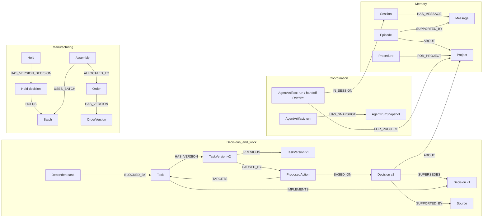
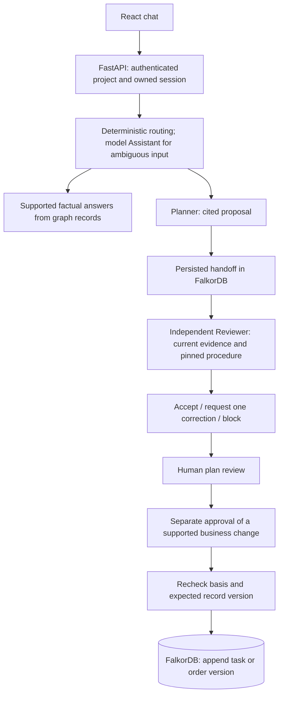

# RelayMind — technical reference

**Agents that remember decisions, hand off work, and catch outdated plans using FalkorDB.**

Graph Hacks: Context for AI Agents · Primary track: **Agent Memory and Coordination**

> Technical companion to the [root README](../../README.md). The root README covers the project, setup, account scenarios and feature index. This reference expands the graph model, architecture and implementation boundaries. Deployment and video links remain pending.

## The problem

A team changes a decision, but an agent continues working from yesterday's conversation. Another agent receives the plan without its evidence. The result is a plausible recommendation based on work that is already outdated.

RelayMind keeps conversations, sourced historical episodes, approved decisions, review procedures and agent handoffs in FalkorDB. A Planner proposes next steps. An independent Reviewer reloads the saved handoff and checks it against current records. When the underlying decisions or manufacturing impact change, the old plan needs revision.

This is a hackathon prototype using synthetic business scenarios. Supported actions update demo task/order records in the graph; no external shipping, payment or messaging systems are connected.

## What you can do

Start with the [user manual and tester guide](USER-MANUAL.md) for a five-minute walkthrough, full feature table, example prompts, expected scenario results and troubleshooting.

- Ask supported questions about current decisions, changed decisions, affected work, exposed orders and your approval history.
- Request a cited plan, pause at its saved handoff, then resume independent review after a decision changes.
- Inspect the sources, historical decisions and task/order versions behind a recommendation.
- Approve, reject or request changes to a specific plan revision. Plan approval records your decision; it applies no business changes.
- Separately prepare and approve a supported task pause or order hold. Approval checks the proposal's basis and expected version again.
- Set up tracked work with explicit dates, timezone, owner and reminder preferences. Reminders are delivered in the conversation by a running worker.
- Receive graph-derived staleness alerts for affected saved plans, approvals and pending actions. Acknowledging an alert does not refresh or approve its target.

## Why FalkorDB is central

The graph determines which approved decisions remain current, which tasks still implement replaced decisions, and which orders are exposed through batch/assembly relationships. These results become planning inputs and deterministic review requirements. FalkorDB also stores the handoff that lets another process review the Planner's work.



These are stored node labels and relationship types. Handoff plans, evidence snapshots and review/procedure references are also stored inside artifact JSON payloads; the diagram does not imply dedicated edges for every reference.

**Current approved decision:** no incoming `SUPERSEDES` edge. Multiple current decisions on one topic are a conflict requiring human resolution. Task/order current versions have no incoming `PREVIOUS` edge. Procedures use separately approved immutable versions, with the review's exact procedure version retained.

### How agents query the graph

Models call validated read-only tools such as `current_decisions`, `memory_context`, `fetch_evidence`, `search_sources`, `affected_tasks`, `trace_dependencies`, `current_hold` and `affected_orders`. Server code selects the authorized graph and supplies fixed parameterized queries. Models never supply Cypher or choose a tenant graph.

For example, current decisions are found by:

```cypher
MATCH (d:Decision)-[:ABOUT]->(:Project {id: $project})
WHERE NOT (d)<-[:SUPERSEDES]-(:Decision)
OPTIONAL MATCH (d)-[:SUPPORTED_BY]->(s:Source)
RETURN d.id, d.topic, d.version, d.text, collect(DISTINCT s.id)
```

The server groups results by topic to detect conflicts. A change's affected work is found by following the old decision:

```cypher
MATCH (t:Task)-[:ABOUT]->(:Project {id: $project})
MATCH (t)-[:IMPLEMENTS]->(old:Decision)<-[:SUPERSEDES]-(replacement:Decision)
RETURN t.id, old.id, collect(DISTINCT replacement.id)
```

The engine requires relevant affected tasks in plan steps and exposed orders in citations, then checks freshness before and after independent review. Complete query logic and scope checks live in [decision storage](../../backend/src/relaymind/memory/decisions.py), [task storage](../../backend/src/relaymind/memory/tasks.py) and [manufacturing storage](../../backend/src/relaymind/memory/manufacturing.py). These examples show read patterns, not the complete authorization or approval implementation.

### Core query implementations

The product depends on Cypher traversals and guarded writes, rather than a named PageRank/centrality algorithm. The examples above and below show the principal read paths. The linked source functions contain the complete queries, parameter handling and failure checks used by the application.

| Product dependency | Complete implementation |
|---|---|
| Current decisions, conflict detection and guarded supersession | [decisions.py: get_current_decisions, record_decision](../../backend/src/relaymind/memory/decisions.py) |
| Affected work, current task versions and dependency reads | [tasks.py: find_affected_tasks, get_task, trace_dependencies](../../backend/src/relaymind/memory/tasks.py) |
| Hold exposure and unknown traceability | [manufacturing.py: current_hold, affected_orders, get_order](../../backend/src/relaymind/memory/manufacturing.py) |
| Owned conversation and sourced episode retrieval | [conversations.py](../../backend/src/relaymind/memory/conversations.py), [episodes.py](../../backend/src/relaymind/memory/episodes.py) |
| Approved procedure lookup | [procedures.py: get_procedure](../../backend/src/relaymind/memory/procedures.py) |
| Bounded lexical source search | [retrieval.py: search_sources](../../backend/src/relaymind/memory/retrieval.py) |
| Saved handoff reads, claim leases and versioned run snapshots | [artifacts.py: ArtifactStore](../../backend/src/relaymind/memory/artifacts.py) |
| Guarded task/order approvals | [actions.py: approve_action, _APPLY, _APPLY_ORDER_HOLD](../../backend/src/relaymind/services/actions.py) |
| Human plan decisions, work setup and reminders | [plan_reviews.py](../../backend/src/relaymind/workflow/plan_reviews.py), [work_setup.py](../../backend/src/relaymind/workflow/work_setup.py), [reminders.py](../../backend/src/relaymind/workflow/reminders.py) |

**Manufacturing impact:** the server resolves the current approved hold decision and supplies `$d`; it is not a model-selected decision.

```cypher
MATCH (:Hold {id: $hold, project_id: $project})
      -[:HAS_VERSION_DECISION]->(d:Decision {id: $d})
      -[:HOLDS]->(b:Batch)<-[u:USES_BATCH]-(a:Assembly)
      -[al:ALLOCATED_TO]->(o:Order)
RETURN o.id, b.id, a.id, u.source_id, al.source_id
ORDER BY o.id, b.id, a.id
```

Missing traceability uses a separate query, so absence of a path does not become a claim of safety:

```cypher
MATCH (:Project {id: $project})<-[:ABOUT]-(o:Order)
WHERE NOT (o)<-[:ALLOCATED_TO]-(:Assembly)
RETURN o.id ORDER BY o.id
```

**Current order version:** absence of an incoming `PREVIOUS` edge determines the head; storage code requires exactly one result.

```cypher
MATCH (:Project {id: $project})<-[:ABOUT]-(o:Order {id: $id})
      -[:HAS_VERSION]->(v:OrderVersion)
WHERE NOT (v)<-[:PREVIOUS]-(:OrderVersion)
RETURN o.id, v.id, v.version, v.status
```

Approval is a separate server operation: it validates the proposal and conflicts, then uses the guarded write in `actions.py` to append a version only while its base and basis are valid. A failed/no-row write is not reported as applied. Handoff claim code uses scope-bound conditional updates and lease tokens. These are implementation mechanisms, not blanket production concurrency guarantees.

## How a request works



Planner and Reviewer use Gemini/Groq provider adapters. The Assistant only selects a route for ambiguous input. Narrator formatting, Overseer checks and Watcher staleness detection are deterministic code. Their checks are bounded safeguards, not proof that arbitrary model prose is correct.

## Demo scenarios

| Scenario | Change | Graph-driven consequence |
|---|---|---|
| Northstar software launch | Payments launch is replaced by free-tier-only scope | Identify `task-01` and `task-02` based on the old decision; review a revised plan and separately approve a task pause |
| Harbor logistics | Port North closes; Route B replaces Route A | Revisit Route A booking and Friday-confirmation tasks against the new route |
| AdventureWorks manufacturing | Quality hold QH-17 expands from batch B101 to B101+B102 | Traverse batches → assemblies → orders; add AW-O103 to exposure, distinguish shipped exposure review, preserve AW-O105 as unknown traceability |

Seeded conversations, decisions and incidents are synthetic. A real-model demo means actual provider calls over this seeded graph. Scripted test providers and fixture-only CLI demonstrations remain separately labeled.

## Run locally

Requirements: Python 3.11+, Node.js 20.19+ or 22.12+, and Docker with Compose. Run these commands from the repository root unless stated otherwise. On Windows, use `.venv\Scripts\python` instead of `.venv/bin/python`.

```sh
git clone https://github.com/jay2323-tech/RelayMInd.git
cd RelayMInd
cp .env.example .env
```

Edit `.env` locally: set `FALKORDB_PASSWORD`, `RELAYMIND_DEMO_PASSWORD`, `AGENT_PROVIDER=gemini`, and your available `GEMINI_MODEL` and `GEMINI_API_KEY`. Optional Groq fallback uses `AGENT_FALLBACK_PROVIDER=groq`, `GROQ_MODEL` and `GROQ_API_KEY`; leave `AGENT_FALLBACK_PROVIDER` empty to disable it. Model availability depends on your account. Keep keys on the server and out of Git.

```sh
docker compose up -d
python3 -m venv .venv
.venv/bin/python -m pip install -r backend/requirements.lock.txt
.venv/bin/python -m pip install -e "./backend[employee-import]"
.venv/bin/python scripts/setup_graph.py
.venv/bin/python scripts/seed_northstar.py --stage before-change
.venv/bin/python scripts/seed_harbor.py --stage before-change
.venv/bin/python scripts/seed_adventureworks.py --stage before-change
```

Install the frontend dependencies in a separate terminal:

```sh
cd frontend
npm ci
```

Then, from the repository root:

```sh
.venv/bin/python scripts/start_demo.py --frontend
```

The starter launches FastAPI, a reminder worker and the Vite development server. Open `http://127.0.0.1:5173`. This command is for local development; it is not a production deployment recipe.

| Username | Company / project |
|---|---|
| `northstar.lead` | Northstar / `launch-01` |
| `northstar.peer` | Northstar / `launch-01`, separate private sessions |
| `harbor.lead` | Harbor / `hb-route-07` |
| `aw.quality` | AdventureWorks / `aw-qh-17` |

Use the demo password you configured. Login is disabled when it is unset. Backend restart requires signing in again; graph-backed conversations and artifacts remain subject to database persistence.

Follow the [demo and verification guide](DEMO.md) to pause a run, change a decision and resume it.

## Verification and limits

Checks run on 18 October 2026 against local checkout `2567ea3` plus pre-existing frontend edits:

- Backend: **209 passed, 127 live-service tests skipped**, three deprecation warnings.
- Frontend: TypeScript check and Vite production build passed; **14 state/link tests passed**.
- No new live-model, live-database or clean-clone setup run was performed for this documentation draft.

Earlier verification records in Git history contain successful real-Gemini Northstar, Harbor and AdventureWorks runs, along with failures and legitimate rejections. The [demo and verification guide](DEMO.md) summarizes their scope. Those historical results are not a fresh deployment acceptance test or a reliability percentage.

Known limits: synthetic accounts with a shared demo password and in-memory server sessions; a single API process for authentication/job management; bounded lexical source search; provider quotas and variable model review quality; in-app reminders requiring a worker; no connected external execution or notification systems. Conversation/episode persistence does not make remembered content approved truth. High-concurrency production behavior is not claimed.

## AI assistance and data attribution

Codex and Claude Code were used extensively for implementation, tests, reviews and documentation under human direction. The [team contributions and AI assistance document](TEAM-CONTRIBUTIONS.md) explains the agreed work split. Earlier detailed development logs remain in Git history.

All demo companies and incidents are fictional. AdventureWorks employee data derives from Microsoft's fictional sample database; [provenance](../../fixtures/adventureworks/provenance.json) and the [Microsoft license notice](../../fixtures/adventureworks/MICROSOFT-LICENSE.txt) are retained. The quality-hold incident is authored synthetic data.

Judge-facing companion documents: [submission write-up](SUBMISSION.md) and [demo and verification guide](DEMO.md). The [team contribution document](TEAM-CONTRIBUTIONS.md) records human responsibilities and AI assistance. Earlier planning and daily-progress files were removed from the working tree; Git history retains previously committed records.
